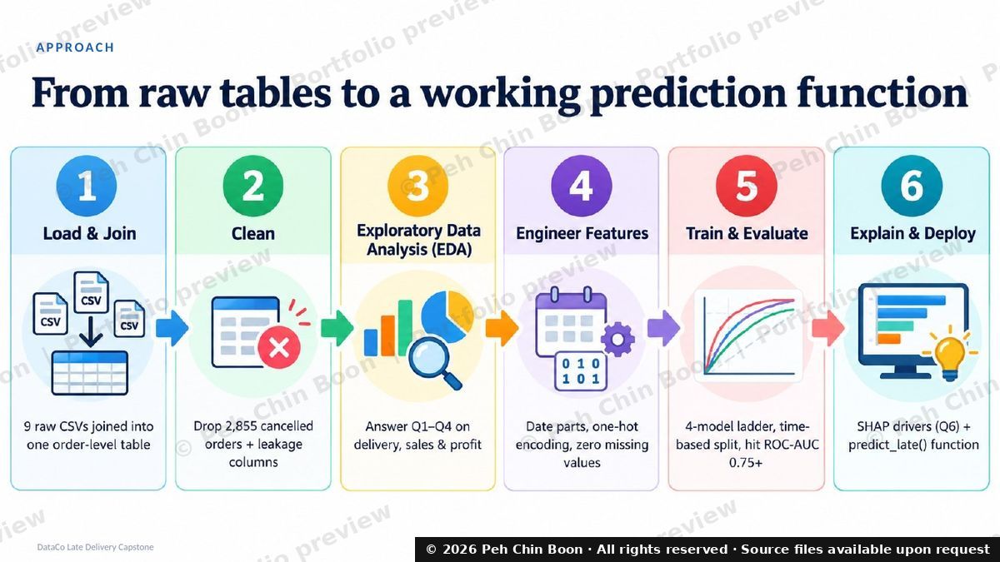
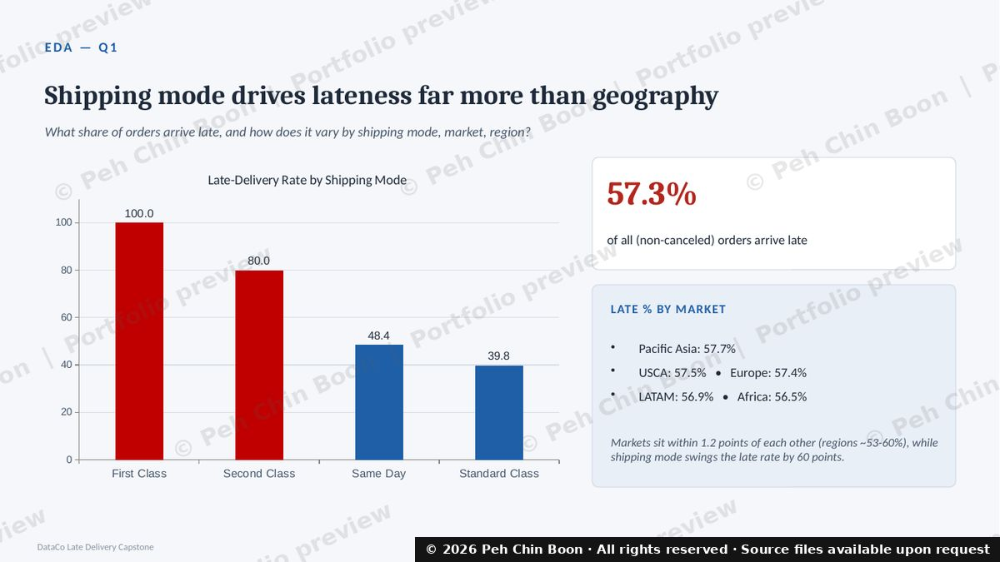
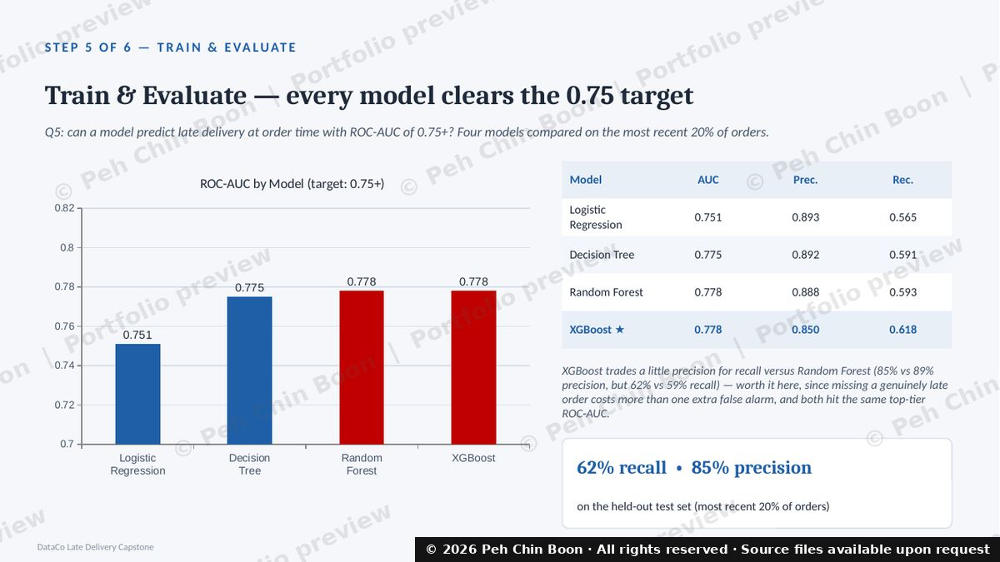
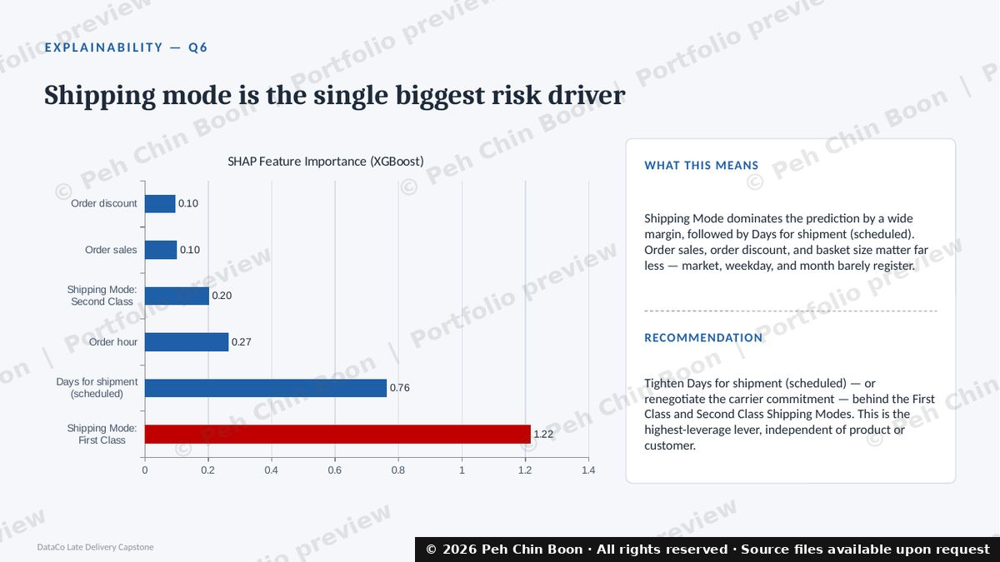
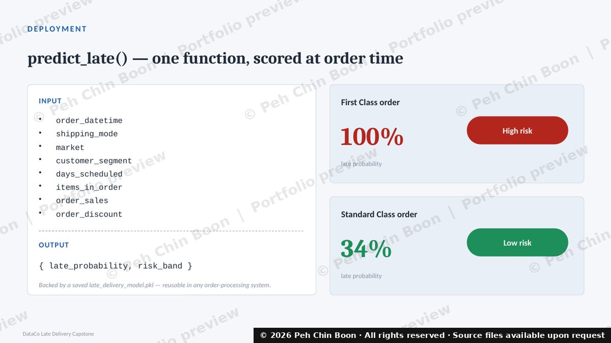

# Predicting Late Deliveries at DataCo

**Machine-learning capstone: flagging at-risk orders at the moment they are placed.**

By **Peh Chin Boon** · Singapore · Completed 9 Oct 2026 · [LinkedIn](https://www.linkedin.com/in/chin-boon-peh/)

Python · pandas · scikit-learn · XGBoost · SHAP · Power BI

> 🔒 **Source files (Jupyter notebook, slide deck, trained model) are available upon request.**
> This repository contains watermarked, reduced-resolution previews only. See [Request the source](#request-the-source).

---

## The problem

DataCo is a global retailer of sports, outdoor, apparel and technology products. More than half of its orders arrive later than promised, which hurts customer trust and repeat sales.

**Goal:** build a classifier, `predict_late()`, that scores an order *at order time* (using only information known at that moment) and answer six business questions along the way.

| | |
|---|---|
| **Data** | 9 linked tables (orders, order lines, shipping, geography, customers, products, categories, departments, payment types); 65,752 orders, Jan 2015 to Jan 2018. Not redistributed here. |
| **Target** | Whether an order arrives late |
| **Success bar** | ROC-AUC of 0.75 or higher |
| **Result** | **ROC-AUC 0.778, 85% precision, 62% recall** on the most recent 20% of orders (held out by time) |



---

## Headline findings

**57.3% of genuinely shipped orders arrive late, and shipping mode is the main driver, not geography.**



| Question | Finding |
|---|---|
| **Q1** Late share by mode / market / region | 57.3% overall. First Class ~100% late, Second Class ~80%, Standard Class ~40%. Markets sit within 1.2 points of each other. |
| **Q2** Promised vs actual days | First and Second Class take roughly **double** their promised window (1→2 days and 2→4 days). Standard Class delivers close to promise. |
| **Q3** Sales and profit drivers | Europe and LATAM lead on sales and profit; Africa is lowest. The top 5 products drive 61% of profit across 118 products. No category loses money overall; two products do. |
| **Q4** Discounts and segments | Discounts do not erode margin here (profit ratio stays between 0.118 and 0.125). Consumer is the largest segment by profit, driven by volume rather than margin. |
| **Q5** Can a model reach AUC 0.75+? | **Yes.** All four models clear the bar; XGBoost selected for the best recall. |
| **Q6** What drives late risk? | Shipping mode by a wide margin, then the promised delivery window. Market, weekday and month barely register. |





---

## What `predict_late()` does

A single function that takes a plain description of an order and returns a risk score and band. It is backed by a saved model bundle (model plus the exact training feature list, so a single new order is encoded the same way as training data).

```text
INPUT   order_datetime, shipping_mode, market, customer_segment,
        days_scheduled, items_in_order, order_sales, order_discount

OUTPUT  { late_probability, risk_band }
```

Same order, only the shipping mode changed: **First Class → 100% late probability (High risk); Standard Class → 34% (Low risk)**, matching what SHAP identified as the dominant driver.



---

## Method in six steps

1. **Load and join:** nine raw tables combined into one order-level table (180,519 order lines collapsed to 65,752 orders; 27 columns).
2. **Data quality checks before trusting anything:** ten checks covering duplicates, missing values, orphan IDs, impossible values, placeholder columns, schema vs data dictionary, duplicate columns, unreliable coordinates, mixed languages and mixed date formats.
3. **Clean:** removed 2,855 canceled orders that never shipped (their "not late" label was not a real outcome).
4. **Exploratory analysis:** answered Q1 to Q4 with charts and numbers.
5. **Feature engineering:** dropped identifiers and leakage columns, derived hour / weekday / month from the order timestamp, one-hot encoded categories (12 → 38 columns, no missing values).
6. **Train, evaluate, explain, deploy:** logistic regression baseline, decision tree, random forest and XGBoost compared with a time-based split; SHAP for explainability; model saved and wrapped in `predict_late()`.

| Model | ROC-AUC | Precision | Recall |
|---|---|---|---|
| Logistic Regression | 0.751 | 0.893 | 0.565 |
| Decision Tree | 0.775 | 0.892 | 0.591 |
| Random Forest | 0.778 | 0.888 | 0.593 |
| **XGBoost (selected)** | **0.778** | 0.850 | **0.618** |

---

## What I learned

- **Check the labels before modelling.** Canceled orders were all labelled "not late" even though they never shipped. Removing them moved the true late rate from 54.8% to 57.3%.
- **Guard against leakage.** Delivery status, actual shipping days and the shipping date are only known after the order ships, so they were excluded from the features.
- **Validate the way the model will be used.** I trained on older orders and tested on the most recent 20%, rather than splitting randomly.
- **Verify data against its documentation.** The real schema differed from the data dictionary, and latitude/longitude did not match the stated countries, so they were treated as unreliable.
- **Pick the metric that fits the business cost.** Missing a genuinely late order costs more than a false alarm, so I accepted a little precision for better recall.
- **Turn the model into an action.** SHAP showed that the shipping promise behind First and Second Class is the highest-leverage lever, which led to a concrete recommendation rather than just a score.

## Limitations and next steps

- Recall is 62%, so roughly four in ten late orders are still missed at the default 0.5 threshold. Tuning the threshold against the cost of a false alarm vs a missed late order is the obvious next step.
- Because shipping mode dominates, the model largely confirms what the EDA already showed. More informative features (carrier, warehouse, product weight, historical lane performance) would be needed to add value beyond the shipping promise.
- Results are from one historical dataset; performance on live orders would need monitoring.

## Recommendations to the business

1. **Tighten First / Second Class promises** (or renegotiate carrier commitments). These modes run at about twice their promised window and are late 80 to 100% of the time.
2. **Review low-profit categories and the Africa market** for pricing and assortment.
3. **Integrate `predict_late()` at checkout** so operations can upgrade shipping or warn the customer proactively.

---

## Skills demonstrated

| Area | Detail |
|---|---|
| Data wrangling | pandas joins and aggregation across 9 tables, data-quality audit, handling mixed formats and placeholder data |
| Machine learning | scikit-learn pipelines, logistic regression, decision tree, random forest, XGBoost; time-based validation; ROC-AUC, precision, recall, confusion matrix |
| Explainability | SHAP feature importance translated into business recommendations |
| Deployment mindset | Saved model bundle and a reusable `predict_late()` scoring function |
| Visualisation and BI | Matplotlib charts; Power BI dashboard (appendix) |
| Communication | Business questions framed up front, findings and recommendations written for non-technical stakeholders |

---

## Appendix: Power BI dashboard


More dashboard pages and the full slide-by-slide walkthrough are in [docs/SLIDE_WALKTHROUGH.md](docs/SLIDE_WALKTHROUGH.md).

---

## Request the source

The full notebook (with outputs), presentation deck and trained model are available upon request.

💼 **Message me on LinkedIn:** [linkedin.com/in/chin-boon-peh](https://www.linkedin.com/in/chin-boon-peh/)

Please mention the company / role you are hiring for. I am also happy to walk through the notebook and the modelling decisions live.

---

© 2026 Peh Chin Boon. All rights reserved. See [LICENSE](LICENSE). The images and text in this repository are previews for portfolio evaluation only and may not be copied, republished or presented as anyone else's work.
